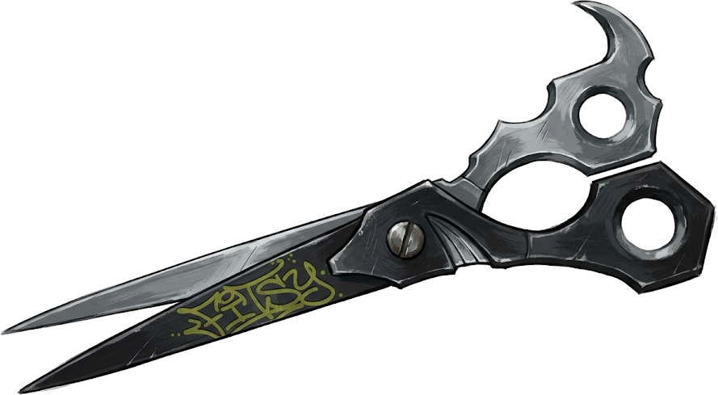

# Fitsy — Street-Editorial Fashion Archive & Digital Wardrobe

<div align="center">



### **The tactile, high-fashion wardrobe curation platform and aesthetic style community.**  
*Infused with the rebellious energy of Gachiakuta street graffiti and the avant-garde couture elegance of JoJo's Bizarre Adventure.*

[](https://nextjs.org/)
[](https://react.dev/)
[](https://www.typescriptlang.org/)
[](https://tailwindcss.com/)
[](https://tonejs.github.io/)
[](https://www.framer.com/motion/)
[](https://supabase.com/)
[](https://capacitorjs.com/)

[**🚀 Try Live Web Application (fitsy.vercel.app)**](https://fitsy.vercel.app) • [Product Overview](#-product-overview) • [Visual Identity](#-visual-identity--design-philosophy) • [Kinetic Animations & Motion](#-kinetic-physics-motion--animation-engine) • [Procedural Sound Engine](#-procedural-zero-asset-sound-engine-tonejs--web-audio-api) • [Key Features](#-key-features) • [Architecture](#-architecture--technologies) • [Author & Connect](#-author--connect)

</div>

---

## 🌟 Product Overview

**Fitsy** is an avant-garde fashion-technology platform engineered to revolutionize how individuals archive, curate, style, and share their physical wardrobes. Transcending generic, sterile digital closet templates, Fitsy synthesizes high-fashion editorial magazine architecture with visceral underground street-art dynamism.

Whether digitizing personal grails with on-device neural vision, crafting spatial editorial moodboards, cycling pieces in the fluid outfit builder, scheduling daily dossiers on the wear calendar, or sharing curated looks within an aesthetic fashion community, Fitsy delivers an uncompromising, tactile experience across desktop, mobile web, and native mobile environments.

Experience the live application: **[fitsy.vercel.app](https://fitsy.vercel.app)**

---

## ⚡ Visual Identity & Design Philosophy

### *"Street-Editorial Manga Brutalism" (50% Gachiakuta × 50% JoJo's Bizarre Adventure)*

Fitsy rejects sterile software tropes in favor of an artistic visual language forged from two complementary counter-cultures:

```
┌─────────────────────────────────────────────────────────────┐
│                      FITSY BRAND IDENTITY                   │
│                                                             │
│   50% GACHIAKUTA                      50% JOJO'S ADVENTURE  │
│   • Heavy Tailor Shears (45° SW)      • Runway Editorial    │
│   • Wildstyle Graffiti Drawing        • 9 Stand Emblems     │
│   • Visceral Melting Ink Drops        • Atelier Gold & Foil │
│   • Jinki Crimson Aura (#FF1E27)      • Alabaster Paper     │
│   • Die-Cut Angular Framing           • 3D Sealing Wax      │
│   • Zero Drop-Shadow Cutouts          • Pure Latin Couture  │
└─────────────────────────────────────────────────────────────┘
```

### 1. ✂️ Primary Brand Emblem — Heavy Tailor Shears (`fitsy-shears.png`)
* **Editorial Tailor Shears**: Positioned at a sharp 45° South-West angle, the heavy forged tailor scissors represent Fitsy's definitive brand signature. It embodies bespoke craftsmanship, artisanal pattern drafting, raw fabric slicing, and deconstructed haute couture.
* **Repurposed Button Mechanics**: The physical garment button has evolved from a static icon into an interactive kinetic loading spinner and tactile micro-control throughout the application.

### 2. 🏙️ 50% Gachiakuta (Brutalist Streetwear & Graffiti Energy)
* **Wildstyle Monoline Graffiti Handstyle**: An authentic street tag brandmark featuring progressive drawing line animations on idle that dynamically melts into rich dripping spray paint on hover or click.
* **Jinki Evolution System**: Garments progress through 3 distinct archival tiers (Tier 1 Common Grails, Tier 2 Archival Artifacts, Tier 3 Awakened Jinki), awakening a pulsing crimson aura (`#jinki-crimson-outline` / `#FF1E27`) and aerosol particle bursts.
* **Strict Zero Drop-Shadow Flat Apparel Cutouts**: Clothing items are presented as clean studio cutouts without artificial software drop shadows, celebrating authentic garment silhouettes, stitch lines, and raw textile drape.
* **Die-Cut Contrast & Angular Framing**: Chamfered borders, deep ink-line accents, and razor-sharp editorial card cuts inspired by street sticker slaps and zine culture.
* **Atmospheric Micro-Mist**: Ultra-lightweight, 60–120 FPS GPU-accelerated aerosol spray mist particles triggered during high-engagement interactions.

### 3. 🏛️ 50% JoJo's Bizarre Adventure (Haute-Couture Editorial & Atelier Hardware)
* **9 Iconic JoJo Emblems**: Custom vector iconography honoring legendary fashion motifs: Jotaro Hand, Bucciarati Zipper, Giorno Ladybug, Rohan Pen Nib, Polnareff Broken Heart, Killer Queen Skull, Stone Ocean Butterfly, Johnny Horseshoe, and Soft & Wet Anchor.
* **Pigmented Atelier Palette**: A high-fashion color system featuring Obsidian Ink (`#0D0D11`), Haute Alabaster Paper (`#F9F8F5`), Antique Gold (`#D4AF37`), Cobalt Ink (`#2048D6`), Hazard Yellow (`#FFE100`), Rust Orange (`#E4572E`), Acid Violet (`#8338EC`), and Muted Olive (`#A3AE46`).
* **Pure Latin Haute-Couture Typography**: Editorial magazine typography exclusively using clean Latin typefaces—zero Katakana or faux-Japanese characters—achieving pure runway elegance.
* **Asymmetrical Runway Dossier Grids**: Editorial lookbook layouts inspired by archival Italian fashion magazines, balancing intense visual density with intentional whitespace.

---

## 💫 Kinetic Physics Motion & Animation Engine

Fitsy is engineered to feel like a living, tactile instrument. Every motion curve is governed by calibrated spring physics, and every component reacts naturally to user touch:

```
┌─────────────────────────────────────────────────────────────┐
│                 KINETIC INTERACTION TAXONOMY                │
├──────────────────────────┬──────────────────────────────────┤
│ Shears State Machine     │ Snip (-22°) → Cut (0.92) → Jam   │
│ Graffiti Drawing Engine  │ Progressive Stroke → Melt Drip   │
│ 5-State Button Engine    │ Idle → Hover → Press → Cut → Spin│
│ Dual Stamping Paradigms  │ 3D Wax Seal Slam vs 120ms Stamp  │
│ Swing Price Tag          │ Pendulum Swing → Sever → Drop    │
│ Scroll Isolation         │ Lenis Inertial + Zero Bleed Lock │
└──────────────────────────┴──────────────────────────────────┘
```

### 🎬 Signature Animation Mechanics

* ✂️ **Heavy Tailor Shears Kinetic State Engine**:
  * **Idle**: Static, razor-sharp 45° SW angled editorial silhouette.
  * **Hover Twitch**: Subtle tactile blade vibration and micro-jitter reacting to cursor presence.
  * **Snip**: Dynamic `rotate(-22deg)` closing motion accompanied by a metallic blade shear sound.
  * **Decisive Cut**: `scale(0.92)` elastic press squish for confirmed actions and deletions.
  * **Frenzy Jam**: `rotate(-35deg)` rapid resistance vibration with metallic clang on high-intensity interactions.

* 🎨 **Progressive Graffiti Tag Drawing & Instant Melt**:
  * On idle and view entry, the monoline "FITSY" graffiti tag draws itself smoothly via progressive SVG path `stroke-dashoffset` interpolation.
  * Upon hover or tap, the brandmark dynamically transitions into a visceral melting state—releasing dripping paint drops synchronized with an aerosol spray mist SFX.

* 🔘 **5-State Interactive Button Engine**:
  * **State 1 — Idle**: Calm atelier texture and subtle border sheen.
  * **State 2 — Hover**: Magnetic spring bounce (`translateY(-2px)`) with dual-tone metallic chime.
  * **State 3 — Active / Press**: Elastic tactile squish (`scale(0.95)`).
  * **State 4 — Snip / Confirm**: Decisive shear cut snap confirming user action.
  * **State 5 — Loading**: High-speed continuous rotation with spinning wheel procedural SFX.

* 🏷️ **Swing Price Tag & "Cut the Tag // Grail Acquired"**:
  * Wishlist garment cards feature an authentic swing price tag suspended by a cotton thread, reacting with real pendulum swing physics to cursor inertia.
  * Clicking the snip button triggers the tailor shears to sever the thread: the tag drops realistically with gravity physics, accompanied by a crisp snip SFX and confetti burst, marking the garment as **"Grail Acquired"**.

* 📜 **Dual Stamping Paradigms: Sealing Wax 3D Stamp vs 120ms Calendar Rubber Stamp**:
  * **Sealing Wax 3D Stamp**: Dedicated to lookbook archival cards, dossier verification, and outfit completions. Features a heavy, slow tactile wax slam with 3D bevel depth, specular gold reflections, and deep wax compression thud audio.
  * **120ms Calendar Rubber Ink Stamp**: Dedicated to daily wear scheduling and calendar logging. Executes a rapid 120ms mechanical slap with a `-4°` organic angle and wet ink edge bleed.

* 🌊 **Inertial Smooth Scrolling & Zero-Bleed Modal Isolation**:
  * Integrated Lenis kinetic smooth scrolling paired with zero-bleed modal scroll locks (`data-lenis-prevent`) guarantees the background canvas remains frozen when inspecting garment dossiers or modals.

* ⚡ **60–120 FPS GPU Compositing**:
  * Animations exclusively target GPU-accelerated properties (`transform`, `opacity`, `filter`) with explicit `will-change: transform` hints to eliminate CPU reflows and prevent layout thrashing.

---

## 🔊 Procedural Zero-Asset Sound Engine (Tone.js + Web Audio API)

Fitsy downloads **0 KB of audio files**. Its entire sonic universe is synthesized algorithmically in the browser using the Web Audio API and Tone.js:

| Interaction Sound | Synthesis Method | Sonic Character |
|---|---|---|
| 💨 **Aerosol Spray Mist** | `Tone.NoiseSynth` + BPF Sweep | White noise sweep mimicking pressurised aerosol spray paint. |
| 🧵 **Fabric & Coat Snap** | Bandpass Filtered Pink Noise Burst | Crisp, tactile snap of raw tailored denim and heavy outerwear. |
| ⚡ **Bag Zipper Tick & Slide** | Descending High-Frequency Micro-Clicks | Rhythmic micro-transients simulating metal teeth interlocking. |
| ✨ **Specular Crystal Chime** | FM Synthesizer Harmonic Arpeggio | High-register arpeggio (E6 → B6 → G#7) for jewelry and luxury accessories. |
| 👞 **Footwear Bass Stomp** | `Tone.MembraneSynth` (G0 Sub-Bass) | Heavy, resonant sub-bass punch grounding boots, loafers, and sneakers. |
| ✂️ **Tailor Shears Blade Snip** | Dual-Pole High-Frequency Friction Burst | Crisp metallic friction and blade release on tag severing. |
| 🔘 **Hardware Button Clink** | Dual-Tone Metallic Resonator | Harmonic metallic ping upon button interactions and loading shifts. |
| ⚙️ **Astrolabe Ratchet Tick** | High-Q Resonant Filter Click | Mechanical detent click for rotary dials and step controls. |
| 💥 **Editorial Pose Impact** | Low-Frequency Sub-Bass Cinematic Boom | Resonant cinematic impact celebrating lookbook saves and milestone achievements. |

---

## 🚀 Key Features

### 1. 👗 Smart Wardrobe Digitization & Neural Vision
* **On-Device Background Removal**: Automatically segments clothing from raw user photos into clean studio cutouts directly in the browser via WebAssembly neural vision models.
* **9 Primary Clothing Categories**: Comprehensive organizational taxonomy encompassing **Tops**, **Bottoms**, **Outerwear**, **Footwear**, **Bags**, **Accessories**, **Underwear / Nightwear**, **Full Body**, and **Swimwear**.
* **3-Tier Deep Taxonomy**: Granular categorization structure accommodating sub-types and hyper-specific garment cuts.
* **Dominant Color Extraction**: Intelligent pixel analysis extracts exact dominant color palettes and HEX codes for seamless wardrobe filtering.
* **Fluid Multi-Currency Pricing**: Responsive price tagging supporting international currency standards with automated thousands-separators.

### 2. ✂️ Tailor Shears Brand Identity & 5-State Button Engine
* **Heavy Tailor Shears (`fitsy-shears.png`)**: Signature atelier emblem angled 45° SW representing bespoke tailoring and sartorial curation.
* **Repurposed Button Spinner**: Garment button repurposed as a high-speed loading spinner with spinning wheel procedural SFX.
* **Interactive Monoline Graffiti Tag**: Progressive drawing animation melting into dripping paint drops with aerosol spray SFX.
* **Zero-Latency Dashboard Return**: Instant tactile navigation back to the primary dossier view.

### 3. 🎨 Hierarchical Outfit Studio & Spatial Moodboard
* **Expanded Dual-Panel Outfit Builder**: Centered garment canvas flanked by integrated navigation controls and fluid sliding category transitions.
* **Aspect-Ratio Preserved HD Export**: 100% pixel-accurate moodboard rendering and export engine—eliminating image stretching or canvas distortion.
* **Freeform Canvas Studio**: Layering, rotation, scaling, and z-index ordering for custom fashion lookbooks.
* **Strict Flat Garment Cutouts**: Pure editorial styling without artificial drop shadows, preserving authentic clothing lines.

### 4. 🏷️ Interactive Wishlist with "Cut the Tag" Physics
* **Pendulum Swing Tags**: Garment cards feature dynamic swinging price tags with realistic mouse inertia.
* **Decisive Shears Severance**: Users can snip the thread with tailor shears, triggering gravity drop physics and confetti celebration to mark items as "Grail Acquired".

### 5. 🌐 Editorial Fashion Community & Social Archive
* **Explore Discovery Feed**: Curated, randomized lookbook streams delivering fresh creator inspirations on every session.
* **Fair-Exposure Friends Feed**: Intelligent round-robin delivery ensuring proportional creator exposure while preserving strict chronological update streams.
* **Garment Inspection**: Directly inspect and explore individual tagged garments from community lookbooks and moodboard posts.
* **Immersive Dynamic Header**: Auto-tucking navigation system that maximizes visual screen real estate during deep scrolling.

### 6. 🔍 Multi-Category Instant Search
* **In-Place Debounced Search**: Rapid filtering across Top Matches, Creator Accounts, Fashion Hashtags, and Community Posts without disruptive full-page popups.
* **Inline Social Graph**: Instant Follow/Unfollow capabilities directly within creator search results.
* **Archival Search History**: Local search persistence with instant clearance and trending aesthetic chips.

### 7. 📅 Outfit Calendar & Archival Wear Tracker
* **120ms Rubber Ink Stamp**: Rapid angled stamp feedback for scheduling upcoming outfits and recording daily wear history.
* **Cost-Per-Wear Analytics**: Track garment frequency and cost efficiency across seasons.
* **Trip Packing Assistant**: Curate multi-day travel wardrobes complete with automated packing checklists.

### 8. 📱 Progressive Web App & Native Mobile Runtime
* **Touch-Optimized Gestures**: Native-feeling mobile gestures, rubber-band overscroll resistance, and bottom drawers.
* **Bilingual Localization**: Instant client-side switching between **English** and **Indonesian (Bahasa Indonesia)**.
* **Cross-Platform Mobile Container**: Seamless native deployment on iOS and Android via Capacitor CLI.

---

## 🛠️ Architecture & Technologies

Fitsy is engineered for uncompromising performance, sub-millisecond perceived latency, and 60–120 FPS rendering:

| Domain | Technology | Implementation Details |
|---|---|---|
| **Core Framework** | [Next.js 16.4](https://nextjs.org/) (App Router) | Full-stack server architecture, Server Actions & optimized bundling |
| **UI Library** | [React 19](https://react.dev/) + [TypeScript 5](https://www.typescriptlang.org/) | Type-safe declarative components and concurrent rendering |
| **Design System** | [Tailwind CSS v4](https://tailwindcss.com/) | Modern atomic CSS, CSS variables, and bespoke design tokens |
| **Brand Identity** | Heavy Tailor Shears (`fitsy-shears.png`) | 45° SW angled tailor shears + monoline graffiti tag with paint melt |
| **Motion & Physics** | [Framer Motion](https://www.framer.com/motion/) + [GSAP](https://greensock.com/) | High-performance spring physics, GPU compositing & timeline choreography |
| **Smooth Scrolling** | [@studio-freight/lenis](https://lenis.darkroom.engineering/) | Inertial kinetic smooth scrolling with strict modal isolation |
| **Procedural Audio** | [Tone.js](https://tonejs.github.io/) + Web Audio API | Zero-asset micro-sound synthesis (spray mist, cloth snap, zipper, chime, stomp, snip, boom) |
| **Expressive Canvas** | [Rough.js](https://roughjs.com/) + [Perfect Freehand](https://github.com/steveruizok/perfect-freehand) | Algorithmic ink strokes, hand-drawn contours & grunge borders |
| **Database & Auth** | [Supabase](https://supabase.com/) (PostgreSQL) | Row Level Security (RLS), real-time indexing & cryptographic sessions |
| **Client-Side AI** | [Transformers.js](https://huggingface.co/docs/transformers.js) + HTML5 Canvas | Local on-device background segmentation & color analysis |
| **Mobile Runtime** | [Capacitor CLI](https://capacitorjs.com/) | Native Android & iOS cross-platform compilation bridges |
| **Hosting & Edge** | [Vercel](https://vercel.com/) | Global Edge network, asset optimization & automated CI/CD pipelines |

---

## 🔒 Proprietary & Closed-Source Notice

**Copyright © 2026 Fitsy. All rights reserved.**

Fitsy is a proprietary commercial product. The full codebase, database schemas, internal algorithms, and brand assets are maintained in a secure private repository.

* For recruitment, technical evaluations, partnerships, or sample access, please contact the author.

---

## 👤 Author & Connect

* **Creator**: [@indofrederika-source](https://github.com/indofrederika-source)
* **Live Product**: [https://fitsy.vercel.app](https://fitsy.vercel.app)
* **Contact**: [indo.frederika@gmail.com](mailto:indo.frederika@gmail.com)

---

<div align="center">
Crafted with passion for street culture, haute-couture fashion, and state-of-the-art web engineering. ✂️🧵✨
</div>
